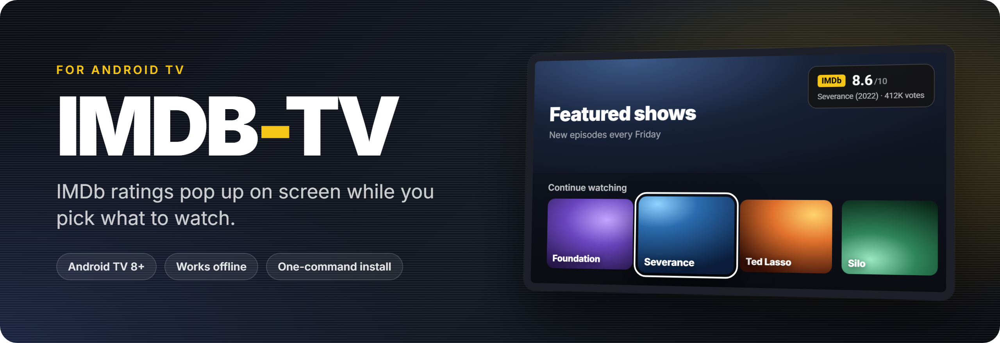
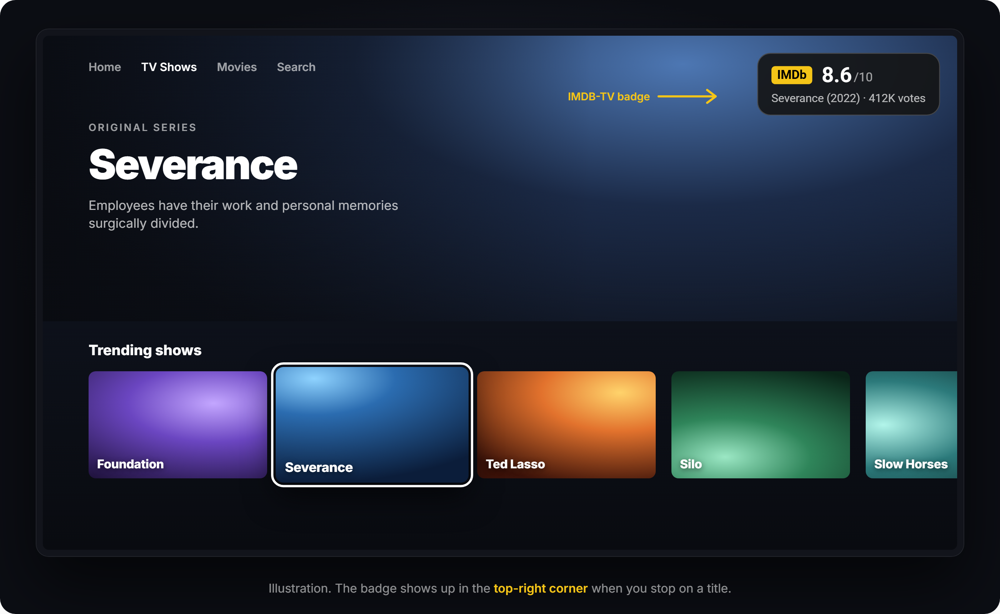
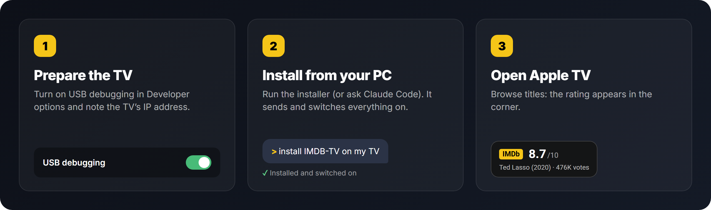
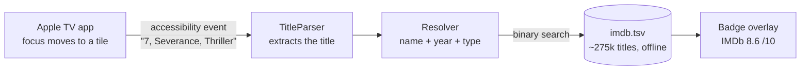

<p align="center">
  
</p>

<p align="center">
  <a href="https://github.com/mirtera157/IMDB-TV/releases/latest"></a>
  
  
  <a href="LICENSE"></a>
</p>

<p align="center">
  <b>English</b> · <a href="README.pt-BR.md">Português (Brasil)</a>
</p>

---

**IMDB-TV** shows a small **IMDb rating badge** in the corner of your Android TV while you browse the
**Apple TV app**. Stop on a show or movie and you see its rating, year and vote count right away, so you
don't have to grab your phone and look it up.

<p align="center">
  
</p>

## Features

- ⭐ **IMDb rating, year and votes** for the selected title, in the top-right corner.
- 📴 **Works offline.** About 275,000 movies and series (every title with 50+ votes) ship inside the app in a 21 MB lookup file. The app has no internet permission at all.
- 🌎 **Localized titles.** It also knows the Brazilian titles, so *Ruptura* finds *Severance*. The badge follows your TV's language (Portuguese or English).
- 🎯 **Picks the right film.** When several titles share a name, the year and the type (series or movie) decide.
- 🪶 **Featherweight.** It has no launcher icon, no settings screen and no background downloads. It is a small accessibility service that only listens to the Apple TV app.
- 🧹 **Out of the way.** The badge disappears after 10 s, when focus moves off a title, or when another app comes to the front.

## Compatibility

| App | Status | Notes |
|---|---|---|
|  Apple TV | ✅ **Works** | Tested with the app in Portuguese. English UI support was added in v1.2 but hasn't been tested on a TV yet, so [tell us](../../issues) if it works for you. |
|  Netflix | ❌ No | The app does not expose titles to Android accessibility (tested). |
|  HBO Max | ❌ No | Same: no titles exposed (tested). |
| Prime Video, Disney+, Google TV home, others | ❔ Untested | If an app exposes titles to accessibility, adding it takes a few lines. [Open an issue](../../issues). |

**TVs:** any Android TV or Google TV running **Android 8.0 or newer**. It was developed on a TCL Android TV 9 (720p).
Reports from other brands (Sony, Philips, Xiaomi, Chromecast with Google TV…) are very welcome.

## Install

<p align="center">
  
</p>

### 1. Prepare the TV (2 minutes)

1. **Turn on Developer options:** *Settings → Device Preferences → About*, then click **Build** 7 times.
2. **Turn on USB debugging:** *Settings → Device Preferences → Developer options → USB debugging* (on some TVs it's called *ADB debugging*).
3. **Find the TV's IP:** *Settings → Network & Internet →* your network (something like `192.168.0.50`). Your PC must be on the **same network**.

> The menu names vary a little by brand. On Google TV, *About* is under *Settings → System*.

### 2. Install from your PC

Pick one:

<details open>
<summary><b>A) Windows (one command)</b></summary>

[Download this repository](../../archive/refs/heads/main.zip), unzip it, open **PowerShell** in the folder and run:

```powershell
powershell -ExecutionPolicy Bypass -File .\install.ps1 -TvIp 192.168.0.50
```

It needs Python 3 (`winget install Python.Python.3.12`). The script sets up a private Python environment and
downloads the latest APK. Then it sends the APK to the TV over Wi-Fi/LAN, installs it and switches it on.
You **don't** need the Android SDK or `adb`.
</details>

<details>
<summary><b>B) macOS / Linux</b></summary>

```bash
git clone https://github.com/mirtera157/IMDB-TV.git && cd IMDB-TV
./install.sh 192.168.0.50
```
</details>

<details>
<summary><b>C) Already have adb?</b></summary>

Download `IMDB-TV.apk` from [Releases](../../releases/latest), then:

```bash
adb connect 192.168.0.50
adb install -r IMDB-TV.apk
adb shell pm grant br.tvvibe.imdbbadge android.permission.WRITE_SECURE_SETTINGS
adb shell settings put secure enabled_accessibility_services br.tvvibe.imdbbadge/.BadgeService
adb shell settings put secure accessibility_enabled 1
```
</details>

<details>
<summary><b>D) Ask an AI agent (Claude Code)</b></summary>

Open the folder in [Claude Code](https://claude.com/claude-code) and type **"install IMDB-TV on my TV"**.
The repo ships a [`CLAUDE.md`](CLAUDE.md) with the full procedure, so the agent asks for what it needs
(the TV's IP, accepting the prompt on the TV) and does the rest.
</details>

When the script connects, the TV asks **"Allow USB debugging?"**. Tick **Always allow** and press **OK**.

### 3. Open the Apple TV app

Browse the rows. The badge shows up after about **10 seconds the first time**, then instantly. When you're done,
you can switch USB debugging off again.

## How it works



- **`BadgeService`** is an Android accessibility service that only listens to the Apple TV app. When focus moves,
  it reads the tile's spoken description (for example *"7, Severance, Thriller"*).
- **`TitleParser` / `Resolver`** strip rank numbers, genres and buttons (*Play*, *Continue*…) and try the
  most likely title.
- **`ImdbDb`** memory-maps `imdb.tsv`, which is sorted by normalized title, and binary-searches it. Nothing is loaded into RAM, which matters on low-memory TVs.
- **`Rearm`**: the Apple TV app only reports titles if accessibility is switched on *while it is already open*. So when
  you open it, the service quickly toggles accessibility (this is what `WRITE_SECURE_SETTINGS` is for, granted over ADB).
  That's why the first badge takes a few seconds.

## FAQ

<details>
<summary><b>Is it safe? What does it access?</b></summary>

It reads the on-screen descriptions **of the Apple TV app only** (`android:packageNames` in
[`badge_service.xml`](android/app/src/main/res/xml/badge_service.xml)). It has **no internet permission**, so it
cannot send anything anywhere. The code is short; have a look in [`android/`](android/app/src/main/java/br/tvvibe/imdbbadge).
</details>

<details>
<summary><b>"Could not reach the TV"</b></summary>

Check the IP, make sure USB debugging is on, and confirm that the TV and the PC are on the same network. If the TV rebooted, its IP may have changed.
If the TV never shows the "Allow USB debugging?" prompt, switch USB debugging off and on, then run the installer again.
</details>

<details>
<summary><b>The badge doesn't show up</b></summary>

- It only works in the **Apple TV app** (see [Compatibility](#compatibility)).
- Give it ~10 seconds after opening the app the first time.
- See what the service is reading: `TV_HOST=<ip> tools/venv/bin/python -I tools/tv.py 'logcat -d -s ImdbBadge'`
  (on Windows, use `tools\venv\Scripts\python.exe`).
</details>

<details>
<summary><b>I use another accessibility service (TalkBack, a remote app…)</b></summary>

The installer sets IMDB-TV as the enabled accessibility service, which replaces the list. Turn the other one back on in
*Settings → Accessibility* afterwards, or set both with
`settings put secure enabled_accessibility_services <other>:br.tvvibe.imdbbadge/.BadgeService`.
</details>

<details>
<summary><b>"pm grant" fails</b></summary>

Some devices (Xiaomi phones do this, some TVs may too) need an extra *USB debugging (Security settings)* switch in Developer options. Without
the permission, the app can't wake up the Apple TV app on its own.
</details>

## Uninstall

```powershell
.\install.ps1 -TvIp 192.168.0.50 -Uninstall        # Windows
./install.sh 192.168.0.50 --uninstall              # macOS / Linux
```

Or just turn it off: *Settings → Accessibility → Notas IMDb*.

## Build from source / refresh the ratings

You need JDK 17 and the Android SDK (`android/local.properties` with `sdk.dir=...`).

```bash
cd android
./gradlew testReleaseUnitTest assembleRelease   # APK in app/build/outputs/apk/release/
```

To refresh the ratings, download `title.ratings`, `title.basics` and `title.akas` (`.tsv.gz`) from
[datasets.imdbws.com](https://datasets.imdbws.com/) into `data/`. Then run:

```bash
python -I scripts/build_db.py data android/app/src/main/assets/imdb.tsv 50
```

Bump `versionCode` in `android/app/build.gradle`, because the TV only re-copies the database when the version changes.

## Contributing

Issues and PRs are welcome, especially:
- **"It works on my TV"** reports (brand, model, Android version, app language).
- **The Apple TV app in other languages.** Run the `logcat` command from the FAQ and paste a few `ImdbBadge` lines into an issue.
- **Other streaming apps** that expose titles to accessibility.

## Disclaimer

IMDB-TV is an independent, non-commercial hobby project. It is **not affiliated with, endorsed by or sponsored by IMDb,
Amazon or Apple**. "IMDb" is a trademark of IMDb.com, Inc. and "Apple TV" is a trademark of Apple Inc.; they are used here only to describe what the app does.
Rating information courtesy of IMDb ([imdb.com](https://www.imdb.com)), from the
[IMDb non-commercial datasets](https://developer.imdb.com/non-commercial-datasets/), for personal and non-commercial use.

## Credits

- The network ADB client in [`tools/`](tools) comes from [cleanyourtv](https://github.com/Gathin23/cleanyourtv) (MIT).
- Code: [MIT](LICENSE).
