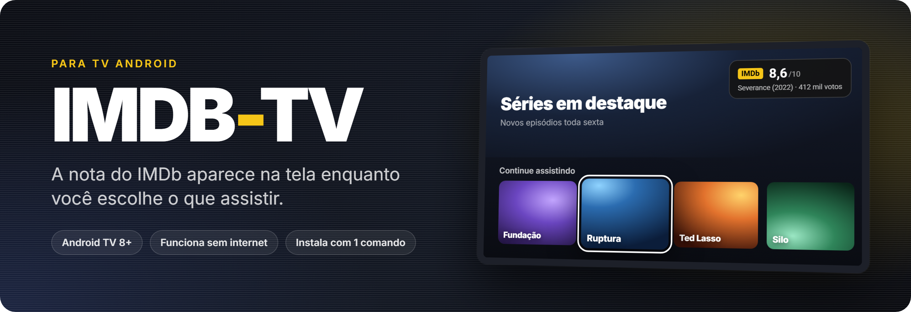
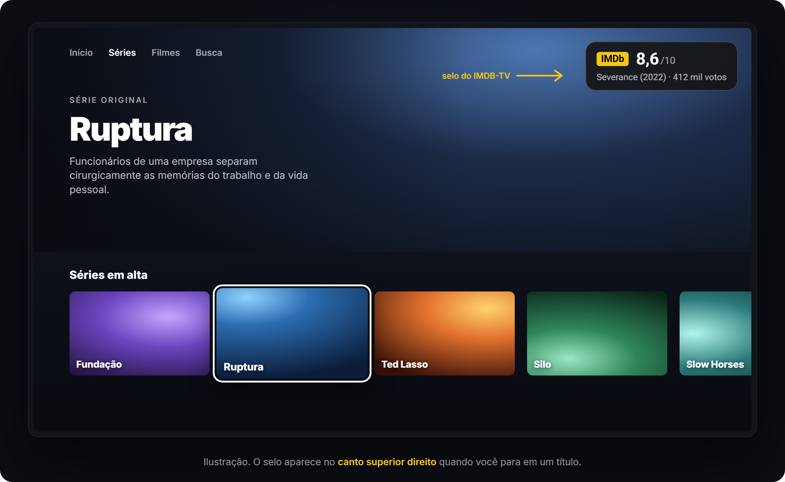
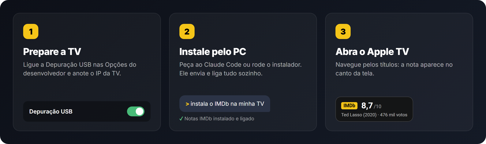
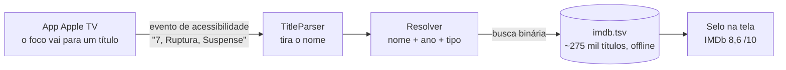

<p align="center">
  
</p>

<p align="center">
  <a href="https://github.com/mirtera157/IMDB-TV/releases/latest"></a>
  
  
  <a href="LICENSE"></a>
</p>

<p align="center">
  <a href="README.md">English</a> · <b>Português (Brasil)</b>
</p>

---

O **IMDB-TV** mostra um **selo com a nota do IMDb** no canto da sua TV Android enquanto você navega pelo
**app Apple TV**. Parou em uma série ou filme, aparecem a nota, o ano e quantos votos ele tem. Não precisa
pegar o celular para pesquisar.

<p align="center">
  
</p>

## O que ele faz

- ⭐ **Nota, ano e votos do IMDb** do título selecionado, no canto superior direito.
- 📴 **Funciona sem internet.** Cerca de 275 mil filmes e séries (todo título com 50+ votos) vão dentro do app, num arquivo de 21 MB. O app nem tem permissão de internet.
- 🇧🇷 **Entende os nomes em português.** Conhece os títulos brasileiros, então *Ruptura* encontra *Severance*.
- 🎯 **Acha o filme certo.** Quando vários títulos têm o mesmo nome, quem decide é o ano e o tipo (série ou filme).
- 🪶 **Levinho.** Não tem ícone, tela de configuração nem downloads. É um pequeno serviço de acessibilidade que só escuta o app Apple TV.
- 🧹 **Não atrapalha.** O selo some depois de 10 s, quando o foco sai do título ou quando outro app abre.

## Apps compatíveis

| App | Funciona? | Observação |
|---|---|---|
|  Apple TV | ✅ **Sim** | Testado com o app em português. O suporte ao app em inglês entrou na v1.2, mas ainda não foi testado numa TV. |
|  Netflix | ❌ Não | O app não informa os títulos para a acessibilidade do Android (testado). |
|  HBO Max | ❌ Não | Também não informa os títulos (testado). |
| Prime Video, Disney+, Globoplay, outros | ❔ Não testados | Se o app informar os títulos, dá para adicionar com poucas linhas. [Abra uma issue](../../issues). |

**TVs:** qualquer Android TV ou Google TV com **Android 8.0 ou mais novo**. Foi desenvolvido numa TCL com Android TV 9 (720p).

## Como instalar

<p align="center">
  
</p>

### 1. Prepare a TV (2 minutos)

1. **Ative as Opções do desenvolvedor:** *Configurações → Preferências do dispositivo → Sobre* e clique **7 vezes** em **Build** (ou "Versão").
2. **Ligue a Depuração USB:** *Configurações → Preferências do dispositivo → Opções do desenvolvedor → Depuração USB* (em algumas TVs aparece como *Depuração ADB*).
3. **Anote o IP da TV:** *Configurações → Rede e Internet →* sua rede (algo como `192.168.0.50`). O PC precisa estar na **mesma rede**.

> Os nomes dos menus mudam um pouco de marca para marca. Na Google TV, o *Sobre* fica em *Configurações → Sistema*.

### 2. Instale pelo PC

Escolha um jeito:

<details open>
<summary><b>A) Windows (um comando)</b></summary>

[Baixe este repositório](../../archive/refs/heads/main.zip), descompacte, abra o **PowerShell** na pasta e rode:

```powershell
powershell -ExecutionPolicy Bypass -File .\install.ps1 -TvIp 192.168.0.50
```

Precisa do Python 3 (`winget install Python.Python.3.12`). O script prepara um Python só dele e baixa o APK mais
novo. Depois envia o APK para a TV pela rede, instala e liga. **Não** precisa de Android SDK nem de `adb`.
</details>

<details>
<summary><b>B) macOS / Linux</b></summary>

```bash
git clone https://github.com/mirtera157/IMDB-TV.git && cd IMDB-TV
./install.sh 192.168.0.50
```
</details>

<details>
<summary><b>C) Já tem o adb?</b></summary>

Baixe o `IMDB-TV.apk` em [Releases](../../releases/latest) e rode:

```bash
adb connect 192.168.0.50
adb install -r IMDB-TV.apk
adb shell pm grant br.tvvibe.imdbbadge android.permission.WRITE_SECURE_SETTINGS
adb shell settings put secure enabled_accessibility_services br.tvvibe.imdbbadge/.BadgeService
adb shell settings put secure accessibility_enabled 1
```
</details>

<details>
<summary><b>D) Peça para uma IA (Claude Code)</b></summary>

Abra a pasta no [Claude Code](https://claude.com/claude-code) e escreva **"instala o IMDB-TV na minha TV"**.
O repositório tem um [`CLAUDE.md`](CLAUDE.md) com o passo a passo completo. O Claude pergunta o que precisa
(o IP da TV, aceitar o aviso na TV) e faz o resto.
</details>

Quando o script conectar, a TV pergunta **"Permitir depuração USB?"**. Marque **Sempre permitir** e aperte **OK**.

### 3. Abra o app Apple TV

Navegue pelas fileiras. Na **primeira vez, o selo leva uns 10 segundos** para aparecer; depois é na hora.
No fim, você pode desligar a Depuração USB de novo.

## Como funciona



- **`BadgeService`** é um serviço de acessibilidade que só escuta o app Apple TV. Quando o foco muda, ele lê a descrição do bloco (por exemplo *"7, Ruptura, Suspense"*).
- **`TitleParser` / `Resolver`** tiram a posição no ranking, o gênero e os botões (*Reproduzir*, *Continuar*…) e testam o nome mais provável.
- **`ImdbDb`** faz busca binária no `imdb.tsv` direto do arquivo, sem carregar nada na memória. Isso importa em TVs com pouca RAM.
- **`Rearm`**: o app Apple TV só informa os títulos se a acessibilidade for ligada *com ele já aberto*. Por isso, quando você abre o app, o serviço desliga e religa a acessibilidade rapidinho; é para isso a permissão `WRITE_SECURE_SETTINGS`, dada pelo ADB. Daí os segundos de espera no primeiro selo.

## Perguntas frequentes

<details>
<summary><b>É seguro? O que ele acessa?</b></summary>

Ele lê as descrições da tela **só do app Apple TV** (`android:packageNames` em
[`badge_service.xml`](android/app/src/main/res/xml/badge_service.xml)). Ele **não tem permissão de internet**, então não consegue enviar nada para lugar nenhum.
O código é curto: dê uma olhada em [`android/`](android/app/src/main/java/br/tvvibe/imdbbadge).
</details>

<details>
<summary><b>"Could not reach the TV"</b></summary>

Confira o IP, se a Depuração USB está ligada e se a TV e o PC estão na mesma rede. Se a TV reiniciou, o IP pode ter mudado.
Se a TV não mostrar o aviso "Permitir depuração USB?", desligue e ligue a Depuração USB e rode o instalador de novo.
</details>

<details>
<summary><b>O selo não aparece</b></summary>

- Só funciona no **app Apple TV** (veja [Apps compatíveis](#apps-compatíveis)).
- Espere uns 10 segundos depois de abrir o app pela primeira vez.
- Para ver o que o serviço está lendo: `TV_HOST=<ip> tools/venv/bin/python -I tools/tv.py 'logcat -d -s ImdbBadge'`
  (no Windows, use `tools\venv\Scripts\python.exe`).
</details>

<details>
<summary><b>Uso outro serviço de acessibilidade (TalkBack, app de controle…)</b></summary>

O instalador deixa o IMDB-TV como serviço de acessibilidade ligado, o que substitui a lista. Depois, religue o outro em
*Configurações → Acessibilidade*, ou ligue os dois com
`settings put secure enabled_accessibility_services <outro>:br.tvvibe.imdbbadge/.BadgeService`.
</details>

## Desinstalar

```powershell
.\install.ps1 -TvIp 192.168.0.50 -Uninstall        # Windows
./install.sh 192.168.0.50 --uninstall              # macOS / Linux
```

Ou só desligue: *Configurações → Acessibilidade → Notas IMDb*.

## Compilar / atualizar as notas

Precisa de JDK 17 e do Android SDK (`android/local.properties` com `sdk.dir=...`).

```bash
cd android
./gradlew testReleaseUnitTest assembleRelease   # APK em app/build/outputs/apk/release/
```

Para atualizar as notas, baixe `title.ratings`, `title.basics` e `title.akas` (`.tsv.gz`) de
[datasets.imdbws.com](https://datasets.imdbws.com/) para a pasta `data/`. Depois rode:

```bash
python -I scripts/build_db.py data android/app/src/main/assets/imdb.tsv 50
```

Aumente o `versionCode` em `android/app/build.gradle`, porque a TV só recopia a base quando a versão muda.

## Aviso

O IMDB-TV é um projeto independente, feito por hobby e sem fins comerciais. **Não tem ligação com IMDb, Amazon ou Apple**, nem apoio
ou patrocínio deles. "IMDb" é marca da IMDb.com, Inc. e "Apple TV" é marca da Apple Inc.; os nomes aparecem aqui só para descrever o que o app faz.
As notas vêm dos [conjuntos de dados não comerciais do IMDb](https://developer.imdb.com/non-commercial-datasets/)
([imdb.com](https://www.imdb.com)), para uso pessoal e não comercial.

## Créditos

- O cliente ADB pela rede em [`tools/`](tools) vem do [cleanyourtv](https://github.com/Gathin23/cleanyourtv) (MIT).
- Código: [MIT](LICENSE).
